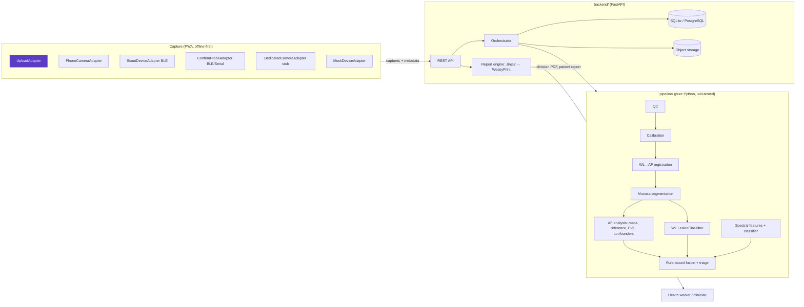

# MukhaSpectra architecture

> Research prototype, not for clinical use. MukhaSpectra is a **screening and triage aid**. It
> flags suspicious findings and assigns a risk level. It never diagnoses. Final diagnosis
> requires a clinician and histopathology.

## 1. What we are building

A health worker at a screening camp holds a phone with the **Scout** clip over a patient's mouth.
For each oral site, Scout captures a white-light (WL) photo and a 405 nm autofluorescence (AF)
photo. Healthy mucosa glows green under violet light; dysplastic tissue loses that glow
(fluorescence visualisation loss, FVL). At a flagged spot, the **Confirm** probe (AS7341, 8
visible channels + clear + NIR) measures diffuse reflectance, where extra blood volume deepens
the 540–580 nm haemoglobin dip.

The software turns those captures, plus a short risk questionnaire, into:

1. a per-lesion and per-patient **risk level** (`LOW` / `MODERATE` / `HIGH` / `INCONCLUSIVE`)
   with the reasons behind it,
2. a clinician referral **PDF report** and a one-page patient report, and
3. a growing, biopsy-labelled dataset. That dataset is the long-term moat.

Two rules shape every design decision:

* **Positioning.** No UI text, report or API field says "diagnosis", "cancer detected" or
  "malignant". We say "risk level", "suspicious finding", "refer for clinical examination /
  biopsy". The only allowed uses of "diagnosis" are the mandated disclaimers ("Screening aid —
  not a diagnosis", "final diagnosis requires a clinician and histopathology"). A test enforces it.
* **Honesty.** We have no trained clinical model and no validation data. No accuracy number is
  hard-coded or displayed. Every model ships as a labelled baseline or placeholder and carries
  `validated: false`. Synthetic data is labelled synthetic in pixels, file names, metadata and
  results, and never feeds a performance claim. Every screen and report shows
  **"Research prototype — not for clinical use"**.

## 2. System overview



Phase 1 implements the upload path end to end: upload WL + AF (+ optional spectrum) → pipeline
→ `ScreeningResult` → clinician PDF.

## 3. Repository layout

```
mukhaspectra/
  pipeline/mukha_pipeline/   pure analysis library (no I/O beyond decoding bytes)
    schema/                  ScreeningResult v1 (pydantic) + generated JSON Schema
    config/                  qc.v1.yaml, analysis.v1.yaml, triage_rules.v1.yaml
    sites.py                 oral site catalogue, contralateral pairing, site-map geometry
    types.py                 internal dataclasses shared by modules
    io/                      image decoding (JPG/PNG/HEIC/DNG), spectral CSV/JSON parsing
    capture/                 CaptureSource abstraction, UploadAdapter, SyntheticSource
    qc/                      image + spectral quality control
    calibration/             flat-field, colour, AF scale, spectral reflectance, expiry
    preprocess/              dark subtraction, corrections, registration, segmentation
    af/                      fluorescence maps, reference normalisation, FVL, confounders, overlay
    wl/                      LesionClassifier interface, ONNX runner, saliency
    spectral/                reflectance summary, features, SpectralClassifier baseline
    fusion/                  rule-based triage
    synthetic/               synthetic WL/AF/spectra generator, demo patients (SYNTHETIC)
    orchestrator.py          analyze_screening(): inputs → ScreeningResult + artifacts
  backend/app/               FastAPI app, DB models, storage, report engine
  frontend/                  React + Vite + TypeScript (Phase 1: analysis console; Phase 2: PWA)
  firmware/                  ESP32 Scout + Confirm (Phase 3)
  ml/                        training/eval, ONNX export, model cards (Phase 4)
  sample_data/               synthetic demo patients (labelled) + bench data slots
  docs/                      this file, data model, report spec, risk register, requirements
```

## 4. The contract: `ScreeningResult` v1

`pipeline/mukha_pipeline/schema/models.py` is the source of truth. The JSON Schema
(`pipeline/mukha_pipeline/schema/screening_result.v1.schema.json`, draft 2020-12) is generated
from it and a test fails on drift. The frontend generates TypeScript types from the JSON Schema.

```
ScreeningResult
├── schema_version "1.0.0", result_id, screening_id, result_version, supersedes_result_id
├── data_provenance (real | synthetic | phantom | ex_vivo | volunteer | mixed), synthetic: bool
├── notices        prototype banner, disclaimer, synthetic notice
├── versions       software, pipeline, schema, rule/qc/analysis config {name, version, sha256},
│                  models[] {component, name, version, status, validated=false, model_card}
├── context        camp, health worker, device IDs, firmware, capture time, language
├── patient        pseudonymous_id, age, sex            (name/contact live in a separate PII table)
├── consent        recorded, method, language, research_use_opt_in
├── risk_factors   smokeless tobacco, smoking, areca nut, alcohol, history, symptoms, irritants
├── sites[]        per oral site
│   ├── visual_flag (lesion seen by eye + appearance), diascopy
│   ├── captures[] {metadata (adapter, device, firmware, LED, exposure, ISO, WB, site,
│   │              calibration id, sha256, synthetic), qc {passed, score, issues[]}}
│   ├── qc, analysis_status, calibration status
│   ├── registration {method, confidence, warp}, segmentation {mucosa fraction, confidence}
│   ├── af {reference (contralateral | analogous | in-image), medians, regions[] {area px/mm²,
│   │       mean/min relative AF, contrast, border irregularity, confounders[]}}
│   ├── wl {status (model_unavailable until weights exist), predictions, saliency (clinician)}
│   ├── artifacts {wl, af, af_registered, heatmap_overlay, relative_af_map, relative_af_grid}
│   └── site_risk_level
├── spectral_readings[] {values ± std, reflectance vs relative signal, QC, features,
│                        delta vs contralateral reference, classifier (placeholder)}
├── lesions[]      {site, origins (af_fvl | visual | wl_model | spectral), risk_level, score,
│                   contributing_factors[] {code, label, source, points}, confounders,
│                   recommended_action}
├── triage         overall_risk_level, score + thresholds, factors, overrides_applied,
│                  recommended_action {code, steps, timeline_days, urgency}, explanation,
│                  requires_clinician_review = true, review_status = pending_review
├── qc_summary, calibration_status, limitations[]
├── processing     working resolution, per-stage timings
└── review         clinician sign-off (Phase 4)
```

Versioning: additive changes bump the minor version; breaking changes get a new major schema
file. Re-analysis never overwrites: it writes `result_version + 1` with `supersedes_result_id`.

## 5. Pipeline design

### 5.1 Conventions
* Images are float32 RGB in [0, 1], shape (H, W, 3). Masks are bool (H, W).
* Analysis runs at a working resolution (longest side 1024 px) in the **WL frame**. AF is warped
  into the WL frame before any per-pixel comparison. The scale factor is recorded.
* Pure functions. The orchestrator returns artifacts as bytes; the backend decides storage.
* Every threshold lives in versioned YAML; every result records the config SHA-256.

### 5.2 Per-site flow (orchestrator)

```
for each site:
  QC(WL), QC(AF), QC(dark)                 → failures block analysis of that site
  dark subtraction, flat-field, colour     → calibration status: calibrated | uncalibrated | expired
  register AF → WL (ECC affine, ORB+RANSAC homography fallback) → confidence → QC
  segment WL → mucosa / teeth / background / specular (Segmenter interface; U-Net later)
  AF maps: green, green/red ratio, AF index (exposure- and calibration-normalised)
  reference green: contralateral site > analogous site > in-image robust median
  relative AF = smoothed green / reference → FVL = relative AF < threshold, cleaned, min area
  per region: area (px, mm²), mean/min relative AF, contrast, border irregularity, solidity
  confounders: red porphyrin (plaque), pigmentation, blood, glare → overlap per region
  heatmap overlay of AF loss on WL; downsampled relative-AF grid for interactive 3D view
  WL LesionClassifier (model_unavailable if no weights) + occlusion saliency (clinician only)
spectral: (S−D)/(W−D) or relative signal → features → delta vs contralateral → classifier
fusion: lesions ← FVL regions ∪ visual flags ∪ WL model ∪ spectral → rule scores → floors
        from clinical red flags → patient level → INCONCLUSIVE safety rule → actions
```

Two passes are needed for contralateral normalisation: pass 1 computes each site's reference
green (robust mucosa median excluding obvious FVL); pass 2 computes relative AF using the paired
site's value when that site passed QC.

### 5.3 Triage rules (v1, transparent)

`config/triage_rules.v1.yaml`, status `baseline_heuristic_unvalidated`. Points per lesion come
from AF (presence, depth, area, border, contrast, with multipliers for reference quality,
diascopy and confounders), the WL model (ignored while unavailable), spectral deltas, the health
worker's own visual observation and site risk. Patient risk factors add a capped amount only when
a lesion exists. Clinical red flags set **floors** the device can never lower (non-healing ulcer
> 2 weeks, red patch, growth, neck lump → HIGH; white patch, ulcer, trismus → MODERATE). LOW is
only allowed when every examined site was analysed; otherwise the result is INCONCLUSIVE.

| Level | Action |
|---|---|
| LOW | Routine re-screening, tobacco and areca-nut cessation counselling. "This does not rule out disease." |
| MODERATE | Remove irritants, re-examine in 2 weeks; refer if the lesion persists. |
| HIGH | Urgent referral for specialist examination and biopsy. |
| INCONCLUSIVE | Retake now; if a lesion is visible or retake impossible, refer for clinical examination. |

### 5.4 Pluggable models
| Interface | Phase 1 implementation | Later |
|---|---|---|
| `Segmenter` | classical HSV/Lab rules + hole filling (keeps white patches inside mucosa) | U-Net (ONNX) |
| `LesionClassifier` | ONNX runner; returns `model_unavailable` when no weights | MobileNetV3/EfficientNet from `ml/` |
| `SpectralClassifier` | rules on lesion-vs-reference deltas, status `placeholder` | logistic regression / small MLP |
| fusion | YAML rules | learned fusion behind the same output |

## 6. Backend

FastAPI + Pydantic v2 + SQLAlchemy 2 + Alembic. SQLite in dev, PostgreSQL in prod.

| Method | Path | Purpose |
|---|---|---|
| GET | `/api/v1/health` | liveness |
| GET | `/api/v1/version` | software, pipeline, schema, config and model versions |
| GET | `/api/v1/schema/screening-result` | the JSON Schema |
| GET | `/api/v1/sites` | site catalogue + site-map geometry |
| POST | `/api/v1/screenings` | multipart upload: `manifest` JSON + image/spectrum files → analysis → result |
| POST | `/api/v1/demo/screenings/{low\|moderate\|high}` | run a SYNTHETIC demo patient |
| GET | `/api/v1/screenings` | list summaries |
| GET | `/api/v1/screenings/{id}` | latest result + version list |
| GET | `/api/v1/screenings/{id}/results/{version}` | a specific result version |
| POST | `/api/v1/screenings/{id}/reanalyze` | new result version with current pipeline/config |
| GET | `/api/v1/screenings/{id}/artifacts/{key}` | stored artifact (PNG/JSON) |
| GET | `/api/v1/screenings/{id}/report.pdf` | clinician report (versioned, stored) |
| GET | `/api/v1/screenings/{id}/report.html` | same report as HTML (preview/debug) |
| GET | `/api/v1/screenings/{id}/sitemap.svg` | oral site map coloured by risk |

Upload manifest (`manifest` form field, JSON):

```json
{
  "patient": {"name": "optional", "external_id": "optional", "age_years": 52, "sex": "male"},
  "consent": {"consent_recorded": true, "method": "checkbox", "language": "en",
              "research_use_opt_in": false},
  "risk_factors": { "...": "RiskFactors" },
  "context": {"screening_site_name": "PHC Hoskote camp", "health_worker_id": "hw-17"},
  "data_provenance": "real",
  "sites": [
    {"site": "buccal_mucosa_left", "wl": "wl_bl", "af": "af_bl", "dark": "dark_bl",
     "visual_flag": {"lesion_seen": true, "appearance": ["white_patch"]},
     "diascopy": "not_done", "px_per_mm": null, "device_id": null},
    {"site": "buccal_mucosa_right", "role": "reference_only", "wl": "wl_br", "af": "af_br"}
  ],
  "spectral_file": "spectrum"
}
```

Each `wl`/`af`/`dark`/`spectral_file` value names a multipart file field. Consent must be
recorded or the request is rejected before anything is stored.

Data model (Phase 1 subset): `patients` (pseudonymous id, age, sex) and `patient_identities`
(PII, separate table), `screenings`, `captures` (storage key, sha256, metadata, QC),
`analysis_results` (versioned JSON), `reports` (versioned PDFs), `calibration_records`,
`audit_events`. Files live in a storage backend (local filesystem in dev) under
`screenings/{id}/inputs/…`, `screenings/{id}/results/v{n}/…`, `screenings/{id}/reports/v{n}/…`.

## 7. Report engine

One `ScreeningResult` → Jinja2 HTML → WeasyPrint PDF. Charts (spectra) are matplotlib SVG; the
site map is SVG built from the shared geometry in `sites.py`; images are embedded as data URIs so
the PDF is self-contained. The clinician report (2–4 pages) follows §6.1 of the brief: header
with versions and calibration status, disclaimer box, minimised patient details and risk factors,
colour-coded risk badge with action and timeline, site map, per-lesion WL | AF | heatmap panels
with measurements, spectral plot, model output and contributing factors, QC and limitations,
clinician review block, referral details with QR code. Synthetic results carry a diagonal
"SYNTHETIC DATA" watermark on every page.

## 8. Frontend (Phase 1 console → Phase 2 PWA)

React + Vite + TypeScript + Tailwind. Phase 1 ships an analysis console: run a synthetic demo
patient or upload WL + AF (+ spectrum), watch the analysis, inspect results (risk with reasons,
WL/AF wipe comparison, AF-loss heatmap, 3D relative-AF terrain, spectra, QC), and download the
PDF. Phase 2 adds the PWA shell, guided capture, i18n (EN/HI/KN), offline storage and ONNX
Runtime Web.

## 9. Phases

| Phase | Scope | Exit criteria |
|---|---|---|
| 1 | Scaffold, schema, QC, registration, segmentation, AF analysis, rule triage, synthetic data, clinician PDF, upload API + console | Upload WL + AF (+ spectrum CSV) → holistic PDF; pipeline coverage ≥ 80% |
| 2 | PWA, guided capture, site map, questionnaire, camera capture, QC feedback, patient report, i18n, offline | Guided flow works offline on Android Chrome |
| 3 | Firmware (Scout, Confirm), BLE adapters, synced capture, probe readings, calibration API, mock devices | Full flow with mock devices; firmware builds |
| 4 | Tele-review, follow-up + biopsy tracking, de-identified dataset export, ML scripts, ONNX, model cards | Signed review changes report; dataset export reproducible |
| 5 | Auth/RBAC, encryption at rest, audit, sync, dashboard, CI, docs, risk register | Security checklist + traceability complete |
